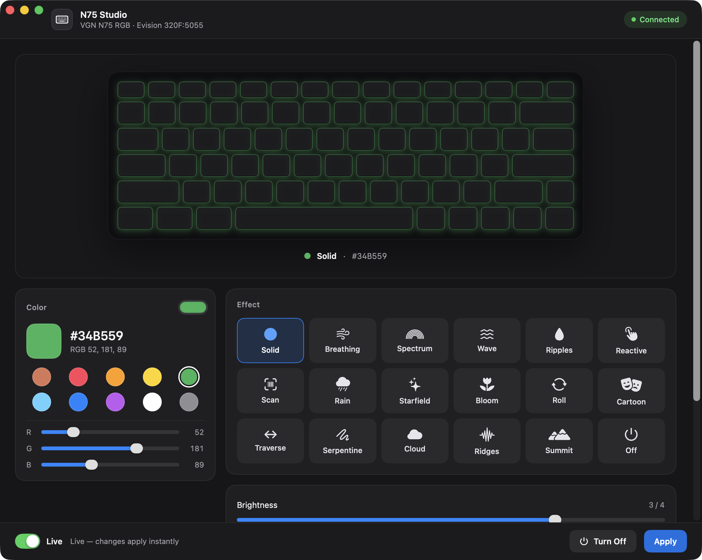
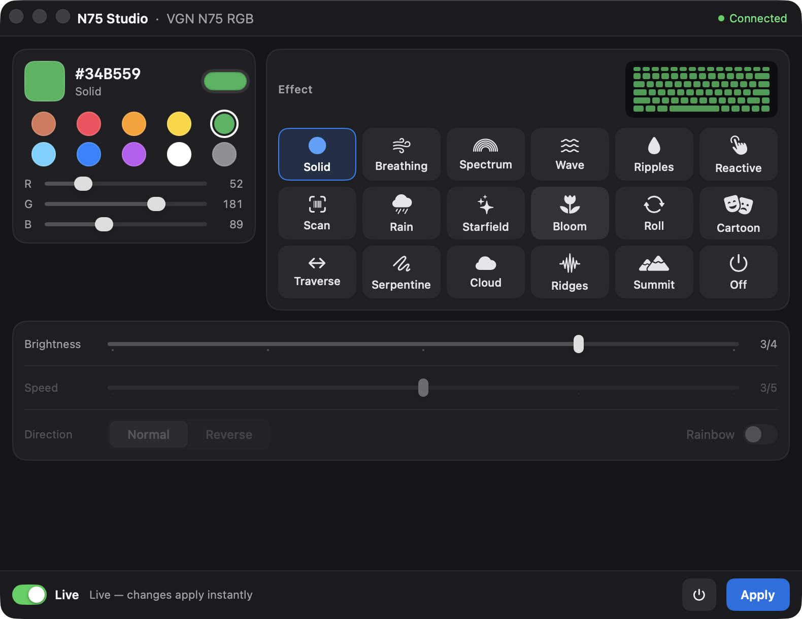

# N75 Studio

[](https://github.com/ismoilovdevml/n75-studio/actions/workflows/build.yml)

RGB lighting control for the VGN N75 keyboard on macOS.

VGN ships configuration software for Windows only, and its WebHID version cannot see the
keyboard in Chrome on a Mac — the board's config interface sits behind a protected keyboard
usage. N75 Studio talks to the keyboard directly over IOKit HID, using the same protocol
dialect the firmware itself expects.



## What it does

- **18 hardware effects** — Solid, Breathing, Spectrum, Wave, Ripples, Reactive, Scan, Rain,
  Starfield, Bloom, Roll, Cartoon, Traverse, Serpentine, Cloud, Ridges, Summit, Off
- **Color** — RGB sliders, ten presets, the system color picker, hex readout
- **Brightness** 0–4, **speed** 1–5, **direction**, and **rainbow** for the effects that cycle colors
- **Live apply** — every change goes to the keyboard as you make it, or switch Live off and use Apply
- **A preview of your own board** — the 75% layout, lit the way the keyboard is

The window has two layouts. Resize it below 980×780 and it switches to a compact one that
fits in a corner of the screen:



## Requirements

- macOS 14 or later
- A VGN N75 RGB (Evision `320F:5055`) over USB
- Xcode command line tools to build (`xcode-select --install`)

Verified on macOS 26 against a VGN N75 RGB. The same controller is sold as VGN S99 and
Kreo Hive, and other Evision boards (for example the AJAZZ AK820) speak the same dialect —
none of those has been tested here.

## Build

```sh
git clone https://github.com/ismoilovdevml/n75-studio.git
cd n75-studio
./build.sh install
```

`./build.sh` alone builds to `build/Release/` without installing.

## Input Monitoring

macOS will not let a process seize a keyboard without the **Input Monitoring** permission, and
seizing is what makes the firmware accept the report. The app asks for it on first launch and
shows a banner while it is missing; grant it in **System Settings → Privacy & Security → Input
Monitoring** and relaunch.

The grant is tied to the app's code signature. An ad-hoc signature changes with every build, so
macOS keeps asking — `build.sh` signs with a stable self-signed certificate called
**N75Studio Local Signing** when one exists in your keychain. To create it once:

1. Keychain Access → *Certificate Assistant* → *Create a Certificate…*
2. Name `N75Studio Local Signing`, type *Code Signing*, self-signed, into the *login* keychain.
3. Open it, expand *Trust*, set *Code Signing* to *Always Trust*.

Then `./build.sh install`. Set `N75_SIGN_IDENTITY` to use a different identity.

## How it works

64-byte output reports on Report ID `0x04`, a 16-bit checksum over the body, and an 18-byte
mode block written inside a `BEGIN` / `WRITE_CONFIG` / `END` transaction. The frame layout, the
command numbers and the effect bytes are written up in [docs/protocol.md](docs/protocol.md).

Nothing is sent anywhere: the app has no network access and writes no files.

## Not implemented

Per-key painting and audio-reactive modes. The data layer for them is in place
(`KreoLayout.swift` maps every key to its LED slot, and the custom-color and dynamic-frame
commands are in `KreoProtocol.swift`), but there is no UI yet.

## Credits

The protocol dialect comes from [kreoctl](https://github.com/myaumyauverse/kreoctl) — see
[THIRD-PARTY.md](THIRD-PARTY.md). MIT licensed; see [LICENSE](LICENSE).
